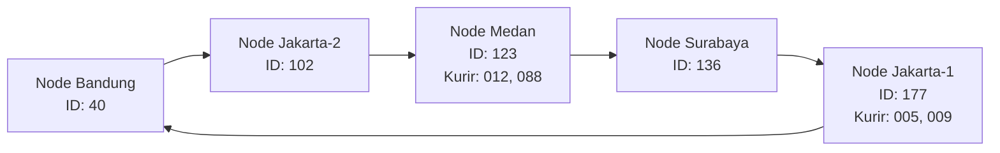
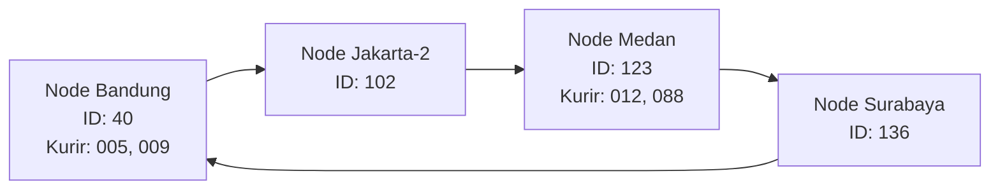

# Jurnal Proses — Tugas 6

**Kelompok:** [INTERCOROPS]

| Nama                   | NIM          | Kontribusi                                                                                                               |
| ---------------------- | ------------ | ------------------------------------------------------------------------------------------------------------------------ |
| ANDI ATHALLAH RADJA    | 103072400034 | Mengimplementasikan fungsi Chord DHT pada chord_simulation.py, menjalankan simulasi, serta menganalisis hasil pengujian. |
| KRISNA PUTRA WICAKSANA | 103072400079 | Menganalisis hasil simulasi dan menyusun jawaban tiga pertanyaan analisis pada README.md berdasarkan output program.     |
| CALVIN IMMANUEL LADO   | 103072400158 |  Mengkaji hasil analisis dan simulasi Chord DHT, mengaitkan perubahan tanggung jawab mapping pada skenario join/leave dengan kebutuhan FoodGo, serta merumuskan kesimpulan dan keterbatasan simulasi dalam JURNAL.md. |                                                                                                      |

## Implementasi find_successor

- Kesalahan pertama yang ditemui: lupa menangani kasus wrap-around (ketika tidak ada node dengan ID ≥ key_hash, harus kembali ke node dengan ID terkecil).
- Cara memperbaikinya: setelah mengurutkan daftar node, lakukan iterasi mencari ID terkecil yang ≥ key_hash; jika tidak ketemu, kembalikan `sorted_nodes[0]`.

### Penyesuaian main()

Skenario `main()` diubah dengan mendaftarkan kurir tambahan yang hash-nya berada pada rentang terdampak, supaya perpindahan tanggung jawab saat join dan leave terlihat di output:

- `kurir-012` (hash=116) dan `kurir-088` (hash=122) → rentang (102, 123] → terdampak join node-medan-1 (id=123)
- `kurir-005` (hash=175) dan `kurir-009` (hash=170) → rentang (136, 177] → terdampak leave node-jakarta-1 (id=177)

Tanpa penyesuaian ini, kurir awal (hash 28, 50, 132) tidak jatuh di rentang yang berubah, sehingga log perpindahan tidak muncul meskipun algoritma sudah benar.

## Skenario join/leave

- Hasil sebelum & sesudah node baru bergabung:
  - Sebelum join node-medan-1 (id=123):
    - `kurir-012` (hash=116) dipegang node 136
    - `kurir-088` (hash=122) dipegang node 136
  - Sesudah join:
    - hash 116 dan 122 berpindah dari node **136 → 123**
    - Ring menjadi: `[40, 102, 123, 136, 177]`
- Hasil sebelum & sesudah node keluar:
  - Sebelum leave node-jakarta-1 (id=177):
    - `kurir-005` (hash=175) dipegang node 177
    - `kurir-009` (hash=170) dipegang node 177
  - Sesudah leave:
    - hash 170 dan 175 berpindah dari node **177 → 40** (wrap-around ke node terkecil)
    - Ring menjadi: `[40, 102, 123, 136]`

### Analisis

## 1. Alasan Penggunaan DHT/Chord

DHT/Chord lebih cocok digunakan pada kasus FoodGo karena sistem perlu menyimpan dan mencari alamat IP kurir yang dapat berubah sewaktu-waktu. Setiap kurir memiliki ID tetap, sedangkan alamat IP-nya dapat berubah mengikuti lokasi atau jaringan yang digunakan.

Perbandingannya dengan metode lain:

- Flat Naming: Jika menggunakan tabel pusat ID Kurir ke alamat IP, seluruh data bergantung pada satu server. Hal ini dapat menjadi bottleneck dan single point of failure apabila server mengalami gangguan.
- DNS Konvensional: DNS dapat menerjemahkan nama menjadi alamat IP, tetapi perubahan alamat IP tetap membutuhkan pembaruan record dan mekanisme propagasi atau cache. Hal ini kurang fleksibel jika perubahan lokasi kurir terjadi secara dinamis.
- DHT/Chord: Data didistribusikan ke beberapa node berdasarkan hasil hashing. Setiap node bertanggung jawab terhadap rentang hash tertentu sehingga pencarian dapat dilakukan tanpa bergantung pada satu server pusat. Ketika node bergabung atau keluar, hanya sebagian mapping yang perlu dipindahkan.
  Dengan demikian, Chord DHT lebih sesuai untuk FoodGo karena mendukung distribusi data, pencarian berdasarkan ID Kurir, dan perubahan topologi secara dinamis.

## 2. Ring Topology

Pada simulasi ini, terdapat empat node awal dengan ID hash 40, 102, 136, dan 177. Setelah node Medan bergabung, ring memiliki lima node. Kemudian node Jakarta keluar sehingga tersisa empat node.

Kondisi setelah node baru bergabung:

Kondisi setelah node Jakarta-1 keluar:

## 3. Perubahan Mapping Ketika Node Keluar

Ketika node node-jakarta-1 dengan ID 177 keluar dari ring, data kurir yang sebelumnya menjadi tanggung jawab node tersebut harus dialihkan ke successor berikutnya.

Berdasarkan hasil simulasi, sebelum node keluar terdapat dua data kurir yang disimpan pada node 177:

- kurir-005 (hash=175)
- kurir-009 (hash=170)
  Setelah node 177 keluar, kedua data tersebut berpindah ke node Bandung dengan ID 40.

Hal ini terjadi karena node 40 menjadi successor berikutnya dalam ring melalui mekanisme wrap-around.

bukti output:
--- Sebuah node keluar ---
[LEAVE] Node 'node-jakarta-1' (id=177) keluar dari ring
-> Data 'kurir-005' (hash=175) pindah dari node 177 ke node 40
-> Data 'kurir-009' (hash=170) pindah dari node 177 ke node 40

Hasil tersebut menunjukkan bahwa sistem tetap dapat menemukan data kurir meskipun salah satu node keluar dari ring. Perubahan ini tidak mengharuskan seluruh data dipindahkan, melainkan hanya data yang sebelumnya menjadi tanggung jawab node yang keluar.

## Log Penggunaan AI (Level 2)

> Wajib diisi sesuai kebijakan Level 2 di [`../RUBRIK-UMUM.md`](../RUBRIK-UMUM.md). Tulis "Tidak memakai AI" pada baris pertama jika memang tidak dipakai. Hanya untuk brainstorming ide/outline — bukan untuk kode/analisis/teks akhir.

| Tanggal | Tool AI | Prompt yang diberikan | Ringkasan saran/ide AI | Bagaimana diolah jadi tulisan/kode sendiri |
|---|---|---|---|---|
| 23-10-2026 | ChatGPT | Meminta peninjauan kode Chord, membandingkan dua versi main(), menanyakan arti output perpindahan tanggung jawab, serta apakah perubahan perlu dicatat di README dan JURNAL | main() yang hanya mendaftarkan kurir dengan hash 28, 50, dan 132 tidak memperlihatkan perpindahan saat topologi berubah. Skenario yang menambahkan hash 116, 122, 170, dan 175 memperlihatkan perpindahan tanggung jawab saat node bergabung dan keluar. IP kurir tetap sama; node penanggung jawabnya yang berubah | Saya membandingkan penjelasan dengan kode dan output yang saya jalankan. Saya memakai hasil aktual untuk memahami skenario, lalu menulis catatan README/JURNAL dengan kata-kata sendiri |
| 01-11-2026 | ChatGPT | MMendiskusikan konsep DHT/Chord, perbandingannya dengan metode penamaan lain, serta mekanisme perubahan mapping ketika terjadi perubahan topologi. | Memberikan gambaran mengenai perbedaan Flat Naming, DNS, dan DHT/Chord, serta hubungan antara successor, ring topology, dan perpindahan data saat node bergabung atau keluar. | Saya mempelajari kembali konsep yang dijelaskan dan mencocokkannya dengan hasil simulasi program. Penjelasan kemudian disesuaikan dengan implementasi dan hasil pengujian kelompok. |
