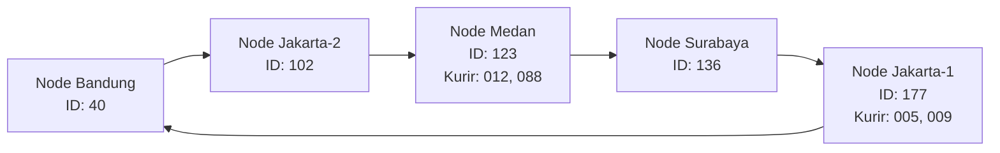
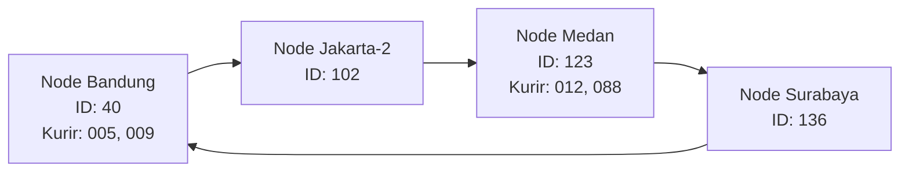

# Tugas 6 (Pekan 6) — Penamaan & Resolusi Lokasi

**Materi terkait:** Flat Naming, Structured Naming (DNS), Distributed Hash Table (DHT)/Chord.

## Studi Kasus

Pelanggan FoodGo kesulitan menemukan alamat IP server kurir yang **dinamis** (kurir berpindah lokasi/jaringan, IP-nya sering berubah). FoodGo butuh cara memetakan **ID Kurir** (identitas tetap) ke **alamat IP terkininya** tanpa server pusat tunggal yang jadi bottleneck/single point of failure.

**Kelompok:** INTERCORPS

| Nama | NIM |
| --- | --- |
| Andi Athallah Radja | 103072400034 |
| Krisna Putra Wicaksana | 103072400079 |
| Calvin Immanuel Lado | 103072400158 |

### Analisis

## 1. Alasan Penggunaan DHT/Chord

DHT/Chord lebih cocok digunakan pada kasus FoodGo karena sistem perlu menyimpan dan mencari alamat IP kurir yang dapat berubah sewaktu-waktu. Setiap kurir memiliki ID tetap, sedangkan alamat IP-nya dapat berubah mengikuti lokasi atau jaringan yang digunakan.

Perbandingannya dengan metode lain:

- Flat Naming: Jika menggunakan tabel pusat ID Kurir ke alamat IP, seluruh data bergantung pada satu server. Hal ini dapat menjadi bottleneck dan single point of failure apabila server mengalami gangguan.
- DNS Konvensional: DNS dapat menerjemahkan nama menjadi alamat IP, tetapi perubahan alamat IP tetap membutuhkan pembaruan record dan mekanisme propagasi atau cache. Hal ini kurang fleksibel jika perubahan lokasi kurir terjadi secara dinamis.
- DHT/Chord: Data didistribusikan ke beberapa node berdasarkan hasil hashing. Setiap node bertanggung jawab terhadap rentang hash tertentu sehingga pencarian dapat dilakukan tanpa bergantung pada satu server pusat. Ketika node bergabung atau keluar, hanya sebagian mapping yang perlu dipindahkan.
  Dengan demikian, Chord DHT lebih sesuai untuk FoodGo karena mendukung distribusi data, pencarian berdasarkan ID Kurir, dan perubahan topologi secara dinamis.

## 2. Ring Topology

Pada simulasi ini, terdapat empat node awal dengan ID hash 40, 102, 136, dan 177. Setelah node Medan bergabung, ring memiliki lima node. Kemudian node Jakarta keluar sehingga tersisa empat node.

Kondisi setelah node baru bergabung:



Kondisi setelah node Jakarta-1 keluar:


## 3. Penelusuran manual lookup("kurir-012")

Penelusuran ini memakai keadaan setelah node-medan-1 bergabung dan sebelum node-jakarta-1 keluar. Node terurut: 40, 102, 123, 136, 177.
  1. lookup("kurir-012") menghitung key_hash = hash_id("kurir-012"). Hasilnya 116.
  2. Program memeriksa self.data. Entri 116 ada, isinya ("kurir-012", "192.168.1.20").
  3. find_successor(116) mengurutkan ID node, lalu mencari ID terkecil yang ≥ 116.
  4. Pemeriksaan berurutan: 40 lebih kecil, 102 lebih kecil, 123 ≥ 116. Pencarian berhenti.
  5. Node 123 adalah node-medan-1. Fungsi mengembalikan 192.168.1.20

Sebelum Medan ada, urutan node hanya 40, 102, 136, 177. ID terkecil yang ≥ 116 adalah 136, sehingga kurir ini tersimpan di Surabaya. Setelah node 123 masuk, successor berubah, tetapi IP kurir tidak berubah. Output program sesuai dengan langkah ini:
-> Data 'kurir-012' (hash=116) pindah dari node 136 ke node 123
[LOOKUP] 'kurir-012' (hash=116) ditemukan di node 123
kurir-012 -> 192.168.1.20

## 4. Perubahan mapping saat node keluar

leave() terlebih dahulu mengumpulkan key yang successor-nya sama dengan node yang akan keluar. Baru setelah itu node dihapus dari ring. Key yang bukan milik node itu tidak dicatat sebagai pindah.

node-jakarta-1 (ID 177) keluar saat ring masih [40, 102, 123, 136, 177]. Node 177 bertanggung jawab atas hash yang lebih besar dari 136 sampai 177, yaitu:
- kurir-009, hash 170
- kurir-005, hash 175

Setelah node 177 dihapus, ring menjadi [40, 102, 123, 136]. Untuk hash 170 dan 175 tidak ada node dengan ID ≥ hash tersebut, sehingga find_successor melakukan wrap-around ke node terkecil, yaitu 40.

[LEAVE] Node 'node-jakarta-1' (id=177) keluar dari ring
  -> Data 'kurir-005' (hash=175) pindah dari node 177 ke node 40
  -> Data 'kurir-009' (hash=170) pindah dari node 177 ke node 40
  [LOOKUP] 'kurir-005' (hash=175) ditemukan di node 40
kurir-005 -> 192.168.1.30
  [LOOKUP] 'kurir-009' (hash=170) ditemukan di node 40
kurir-009 -> 192.168.1.31

IP kurir tetap sama. Yang berubah hanya node penyimpan mapping, dan lookup setelah leave tetap berhasil. Simulasi berjalan dalam satu proses, jadi kegagalan node mendadak di jaringan sungguhan belum diuji.

## Kesimpulan Analisis

Berdasarkan analisis dan simulasi, DHT/Chord sesuai dengan kebutuhan FoodGo untuk memetakan ID kurir yang tetap ke alamat IP yang dapat berubah. Pembagian tanggung jawab mapping ke beberapa node mengurangi ketergantungan pada server pusat, sementara pembaruan mapping tetap diperlukan saat IP kurir berubah. Mekanisme consistent hashing dan successor memungkinkan penyesuaian tanggung jawab ketika topologi ring berubah. Saat node Medan bergabung, mapping kurir-012 dan kurir-088 beralih ke node 123. Ketika node Jakarta-1 keluar, mapping kurir-005 dan kurir-009 dialihkan dari node 177 ke node 40 melalui wrap-around. Perubahan tersebut hanya memengaruhi sebagian mapping sehingga seluruh data tidak perlu dipindahkan. Hasil simulasi menunjukkan bahwa mapping tetap dapat ditemukan setelah perubahan topologi yang diuji. Namun, karena simulasi berjalan dalam satu proses, ketahanan terhadap kegagalan node secara mendadak belum diuji dan memerlukan pengembangan lebih lanjut.

### Cara Menjalankan

```bash
python3 src/chord_simulation.py
```
