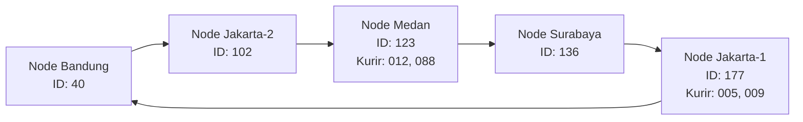
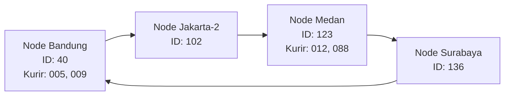

# Tugas 6 (Pekan 6) — Penamaan & Resolusi Lokasi

**Materi terkait:** Flat Naming, Structured Naming (DNS), Distributed Hash Table (DHT)/Chord.

## Studi Kasus

Pelanggan FoodGo kesulitan menemukan alamat IP server kurir yang **dinamis** (kurir berpindah lokasi/jaringan, IP-nya sering berubah). FoodGo butuh cara memetakan **ID Kurir** (identitas tetap) ke **alamat IP terkininya** tanpa server pusat tunggal yang jadi bottleneck/single point of failure.

### Analisis

## 1. Alasan Penggunaan DHT/Chord

DHT/Chord lebih cocok digunakan pada kasus FoodGo karena sistem perlu menyimpan dan mencari alamat IP kurir yang dapat berubah sewaktu-waktu. Setiap kurir memiliki ID tetap, sedangkan alamat IP-nya dapat berubah mengikuti lokasi atau jaringan yang digunakan.

Perbandingannya dengan metode lain:

- Flat Naming: Jika menggunakan tabel pusat ID Kurir ke alamat IP, seluruh data bergantung pada satu server. Hal ini dapat menjadi bottleneck dan single point of failure apabila server mengalami gangguan.
- DNS Konvensional: DNS dapat menerjemahkan nama menjadi alamat IP, tetapi perubahan alamat IP tetap membutuhkan pembaruan record dan mekanisme propagasi atau cache. Hal ini kurang fleksibel jika perubahan lokasi kurir terjadi secara dinamis.
- DHT/Chord: Data didistribusikan ke beberapa node berdasarkan hasil hashing. Setiap node bertanggung jawab terhadap rentang hash tertentu sehingga pencarian dapat dilakukan tanpa bergantung pada satu server pusat. Ketika node bergabung atau keluar, hanya sebagian mapping yang perlu dipindahkan.
  Dengan demikian, Chord DHT lebih sesuai untuk FoodGo karena mendukung distribusi data, pencarian berdasarkan ID Kurir, dan perubahan topologi secara dinamis.

## 2. Ring Topology

Pada simulasi ini, terdapat empat node awal dengan ID hash 40, 102, 136, dan 177. Setelah node Medan bergabung, ring memiliki lima node. Kemudian node Jakarta keluar sehingga tersisa empat node.

Kondisi setelah node baru bergabung:



Kondisi setelah node Jakarta-1 keluar:


## 3. Perubahan Mapping Ketika Node Keluar

Ketika node node-jakarta-1 dengan ID 177 keluar dari ring, data kurir yang sebelumnya menjadi tanggung jawab node tersebut harus dialihkan ke successor berikutnya.

Berdasarkan hasil simulasi, sebelum node keluar terdapat dua data kurir yang disimpan pada node 177:

- kurir-005 (hash=175)
- kurir-009 (hash=170)
  Setelah node 177 keluar, kedua data tersebut berpindah ke node Bandung dengan ID 40.

Hal ini terjadi karena node 40 menjadi successor berikutnya dalam ring melalui mekanisme wrap-around.

bukti output:
--- Sebuah node keluar ---
[LEAVE] Node 'node-jakarta-1' (id=177) keluar dari ring
-> Data 'kurir-005' (hash=175) pindah dari node 177 ke node 40
-> Data 'kurir-009' (hash=170) pindah dari node 177 ke node 40

Hasil tersebut menunjukkan bahwa sistem tetap dapat menemukan data kurir meskipun salah satu node keluar dari ring. Perubahan ini tidak mengharuskan seluruh data dipindahkan, melainkan hanya data yang sebelumnya menjadi tanggung jawab node yang keluar.

## Kesimpulan Analisis

Berdasarkan analisis dan simulasi, DHT/Chord sesuai dengan kebutuhan FoodGo untuk memetakan ID kurir yang tetap ke alamat IP yang dapat berubah. Pembagian tanggung jawab mapping ke beberapa node mengurangi ketergantungan pada server pusat, sementara pembaruan mapping tetap diperlukan saat IP kurir berubah. Mekanisme consistent hashing dan successor memungkinkan penyesuaian tanggung jawab ketika topologi ring berubah. Saat node Medan bergabung, mapping kurir-012 dan kurir-088 beralih ke node 123. Ketika node Jakarta-1 keluar, mapping kurir-005 dan kurir-009 dialihkan dari node 177 ke node 40 melalui wrap-around. Perubahan tersebut hanya memengaruhi sebagian mapping sehingga seluruh data tidak perlu dipindahkan. Hasil simulasi menunjukkan bahwa mapping tetap dapat ditemukan setelah perubahan topologi yang diuji. Namun, karena simulasi berjalan dalam satu proses, ketahanan terhadap kegagalan node secara mendadak belum diuji dan memerlukan pengembangan lebih lanjut.

### Cara Menjalankan

```bash
python3 src/chord_simulation.py
```
