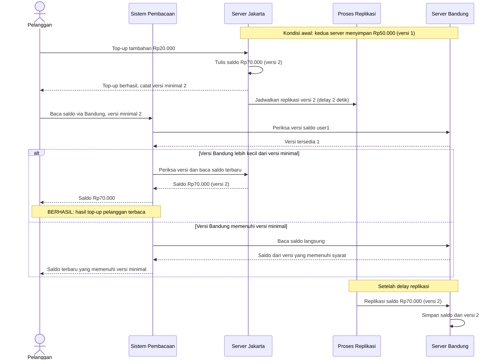

# Tugas 7 (Pekan 7) — Konsistensi Data

**Materi terkait:** Data-Centric Consistency (Sequential, Eventual), Client-Centric Consistency.

## Studi Kasus

Data saldo *e-wallet* pelanggan FoodGo berbeda antara server wilayah **Jakarta** dan **Bandung** karena replikasi antar server berjalan lambat. Contoh kasus nyata: pelanggan top-up saldo lewat server Jakarta, lalu dalam hitungan detik memesan makanan lewat aplikasi yang tersambung ke server Bandung — saldo belum ter-update, transaksi ditolak padahal saldo sebenarnya cukup.

## 1. Analisis Sequential vs Eventual + Usulan Solusi
Analisis Model Konsistensi
Pada kasus e-wallet FoodGo, terdapat dua server (Jakarta dan Bandung) yang saling mereplikasi data saldo. Ketika pelanggan melakukan top-up di server Jakarta, data saldo belum tentu langsung tersedia di server Bandung karena adanya delay replikasi. Akibatnya, pelanggan yang segera melakukan pemesanan melalui server Bandung dapat mengalami penolakan transaksi meskipun saldo sebenarnya sudah mencukupi.

Dalam konteks ini, Eventual Consistency tidak cukup. Eventual Consistency memang memungkinkan sistem berjalan lebih cepat karena replikasi dilakukan secara asinkron, namun inkonsistensi sementara yang terjadi sangat berisiko pada data yang menyangkut uang. Berbeda dengan data non-kritis seperti jumlah like di media sosial, kesalahan pada saldo e-wallet dapat menurunkan kepercayaan pengguna dan berdampak langsung pada pengalaman serta reputasi layanan.
Sequential Consistency dapat menjamin bahwa semua replika melihat urutan operasi yang sama. Namun pendekatan ini terlalu ketat dan mahal karena setiap operasi tulis harus menunggu sinkronisasi ke seluruh replika sebelum dianggap selesai. Hal ini dapat meningkatkan latency secara signifikan, terutama pada sistem yang tersebar secara geografis.

Solusi yang lebih tepat adalah menerapkan Client-Centric Consistency, khususnya model Read-Your-Writes. Dengan mekanisme ini, pelanggan yang baru saja melakukan top-up di server Jakarta akan selalu melihat saldo terbarunya sendiri pada operasi baca berikutnya, meskipun proses replikasi ke server Bandung belum selesai. Pendekatan ini memberikan jaminan yang cukup kuat bagi pengguna tanpa harus memaksa seluruh sistem menjadi Sequential Consistency.
## Tugas Kelompok

## 2. Usulan Solusi: Client-Centric Consistency (Read-Your-Writes)

Solusi yang dipilih adalah **Read-Your-Writes (RYW)**, dengan jaminan Client-Centric Consistency. Mekanisme ini memastikan bahwa setelah pelanggan melakukan penulisan yang berhasil, pembacaan berikutnya oleh pelanggan yang sama tidak kembali ke versi sebelum penulisan tersebut.
Dalam simulasi, setiap pembaruan saldo diberi nomor versi. Aplikasi atau sesi pelanggan mengingat **versi minimal** dari top-up terakhir. Saat hendak membaca saldo di Bandung, sistem membandingkan versi data di Bandung dengan versi minimal tersebut:

1. Jika versi Bandung **lebih besar atau sama dengan** versi minimal, saldo dibaca langsung dari Bandung.
2. Jika versi Bandung **lebih kecil**, sistem tidak menggunakan data lamanya dan mengalihkan pembacaan ke Jakarta, yaitu replika yang telah menerima top-up.
3. Setelah replikasi selesai, Bandung dapat kembali melayani pembacaan langsung karena versinya sudah memenuhi syarat.

## 3. Sequence Diagram

### 3.1 Tanpa Read-Your-Writes (Bug)

```mermaid
sequenceDiagram
    actor P as Pelanggan
    participant J as Server Jakarta
    participant R as Proses Replikasi
    participant B as Server Bandung

    P->>J: Top-up Rp50.000 untuk user1
    J->>J: Baca saldo Rp0, tulis Rp50.000 (versi 1)
    J-->>P: Top-up berhasil, versi 1
    J->>R: Jadwalkan replikasi versi 1 (delay 2 detik)
    Note over P,B: Setelah 0,5 detik, pelanggan membaca melalui Bandung
    P->>B: Baca saldo user1
    B->>B: Data masih Rp0 (versi 0)
    B-->>P: Saldo Rp0
    Note over P,B: BUG: inconsistent read; pemesanan berisiko ditolak
    Note over R,B: Setelah delay 2 detik
    R->>B: Replikasi saldo Rp50.000 (versi 1)
    B->>B: Simpan saldo dan versi terbaru
```

**Titik kegagalan:** Bandung melayani pembacaan sebelum memperoleh hasil top-up di Jakarta. Pembaruan pada akhirnya sampai ke Bandung, tetapi pelanggan sudah lebih dahulu menerima saldo lama.

### 3.2 Dengan Read-Your-Writes (Bug Teratasi)



**Titik perbaikan:** Pemeriksaan versi mencegah Bandung mengembalikan data versi 1 kepada pelanggan yang baru saja menulis versi 2. Pembacaan dialihkan ke Jakarta sampai Bandung memiliki data yang cukup baru. Pada kode simulasi, pengalihan ini dilakukan oleh fungsi `baca_saldo_read_your_writes()`.

## 4. Skenario Tambahan: Pelacakan Lokasi Kurir RideNow

### 4.1 Deskripsi Skenario

RideNow merupakan contoh aplikasi transportasi online yang menampilkan lokasi kurir secara langsung kepada pelanggan.

Ketika kurir berpindah lokasi, sistem secara berkala memperbarui koordinat kurir. Pembaruan tersebut direplikasi ke beberapa server agar pelanggan dapat memantau posisi kurir.

Namun, keterlambatan replikasi dapat menyebabkan server tertentu menampilkan lokasi kurir beberapa detik lebih lambat daripada kondisi sebenarnya.

### 4.2 Pemilihan Model Konsistensi

Untuk kasus pelacakan lokasi kurir, model yang dipilih adalah **Eventual Consistency**.

Alasan pemilihannya adalah:

1. Posisi kurir berubah secara terus-menerus sehingga pembaruan data dilakukan dengan frekuensi tinggi.
2. Keterlambatan posisi selama beberapa detik masih dapat ditoleransi untuk kebutuhan tampilan peta.
3. Replikasi asinkron membantu mengurangi kebutuhan koordinasi antarreplika pada setiap pembaruan lokasi.
4. Data lokasi tidak memiliki risiko finansial langsung sebesar data saldo e-wallet.

Walaupun demikian, sistem perlu membatasi umur data lokasi agar informasi yang ditampilkan tidak terlalu lama. Penggunaan timestamp atau nomor versi juga dapat membantu mencegah pembaruan lama menimpa koordinat yang lebih baru.

### 4.3 Perbandingan dengan FoodGo

| Aspek | FoodGo (Saldo E-Wallet) | RideNow (Lokasi Kurir) |
|---|---|---|
| Jenis data | Saldo pelanggan | Koordinat lokasi kurir |
| Dampak keterlambatan | Top-up tidak terlihat dan pesanan berisiko ditolak | Lokasi kurir terlambat diperbarui |
| Toleransi keterlambatan | Rendah | Relatif lebih tinggi |
| Model yang dipilih | Read-Your-Writes untuk pembacaan setelah top-up | Eventual Consistency |
| Pertimbangan utama | Ketepatan pembacaan saldo dan kepercayaan pelanggan | Efisiensi pembaruan lokasi secara berkala |

### 4.4 Kesimpulan Skenario Tambahan

Pemilihan model konsistensi harus mempertimbangkan karakteristik data dan dampak bisnis yang ditimbulkan.

Pada FoodGo, Read-Your-Writes diperlukan agar pelanggan dapat langsung melihat hasil top-up. Sebaliknya, pada sistem pelacakan lokasi RideNow, Eventual Consistency lebih sesuai karena keterlambatan pembaruan posisi dalam batas tertentu masih dapat ditoleransi.


### Bagian 1 — Analisis (wajib)

1. Tentukan: apakah kasus ini **membutuhkan Sequential Consistency** (semua replika melihat urutan operasi yang sama) atau **cukup Eventual Consistency** (replika akan konsisten "pada akhirnya", boleh sementara berbeda)? Berikan argumen berbasis dampak bisnis (mis. kasus saldo *e-wallet* jauh lebih sensitif dibanding kasus "jumlah like" di media sosial).
2. Jika kalian menyimpulkan Eventual Consistency saja **tidak cukup** untuk skenario ini, usulkan pendekatan **Client-Centric Consistency** yang relevan (mis. *Read-Your-Writes*: pelanggan yang baru top-up harus selalu melihat saldo terbarunya sendiri, walau replika lain belum sinkron).
3. Gambarkan **diagram alir urutan (sequence diagram)** yang menunjukkan operasi read/write antara pelanggan, server Jakarta, server Bandung, dan proses replikasi — untuk skenario **tanpa** jaminan konsistensi (bug terjadi) DAN skenario **dengan** solusi yang kalian usulkan (bug teratasi). Pakai Mermaid (`sequenceDiagram`) di `README.md` — lihat contoh cara pakai di Tugas 2.

### Bagian 2 — Simulasi (opsional, nilai tambah)

Skeleton `src/replica_simulation.py` mensimulasikan dua replika (Jakarta & Bandung) dengan delay replikasi buatan. Lengkapi TODO untuk:
1. Menunjukkan kondisi **inconsistent read** (replika Bandung masih menunjukkan saldo lama walau Jakarta sudah update).
2. Mengimplementasikan mekanisme **Read-Your-Writes** sederhana (mis. dengan version/timestamp per client) yang memperbaiki masalah tersebut.

```bash
python3 src/replica_simulation.py
```


## Struktur Submission

```
tugas-07-konsistensi-data/
├── README.md      # Analisis konsistensi + sequence diagram Mermaid
├── JURNAL.md
├── src/            # (opsional) simulasi replikasi
└── bukti/          # (jika mengerjakan simulasi) output program
```

## Rubrik Penilaian (Tugas 7)

| Komponen | Bobot | Kriteria |
|---|---|---|
| Ketepatan pemilihan model konsistensi | 30% | Argumen berbasis dampak bisnis nyata, bukan hafalan definisi |
| Kualitas sequence diagram | 30% | Menunjukkan jelas titik kegagalan & titik perbaikan |
| Usulan solusi client-centric | 25% | Solusi konkret dan dapat diimplementasikan (bukan wacana abstrak) |
| Proses & kontribusi kelompok | 15% | `JURNAL.md`, commit history (+ bonus jika simulasi dikerjakan) |

## Batasan Penggunaan AI (Level 2)

Kebijakan **Level 2 (AI Assisted Idea Generation & Structuring)** berlaku — lihat [`../RUBRIK-UMUM.md`](../RUBRIK-UMUM.md). Boleh bertanya konsep umum consistency model ke AI untuk brainstorming; **tidak boleh** meminta AI menuliskan analisis akhir/sequence diagram atau isi `# TODO` di `src/replica_simulation.py` yang tinggal ditempel. Catat pemakaian AI di "Log Penggunaan AI" pada `JURNAL.md`.

- Sebagai bukti pemahaman konsep (bukan hafalan jawaban skenario FoodGo saja), `README.md` wajib menyertakan **satu skenario tambahan** yang kalian buat sendiri (mis. kasus lain di aplikasi ojek online) dan menentukan model konsistensi yang tepat untuk skenario tambahan tersebut.
