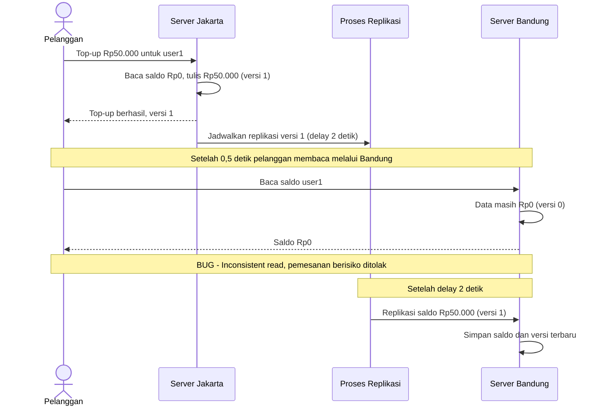
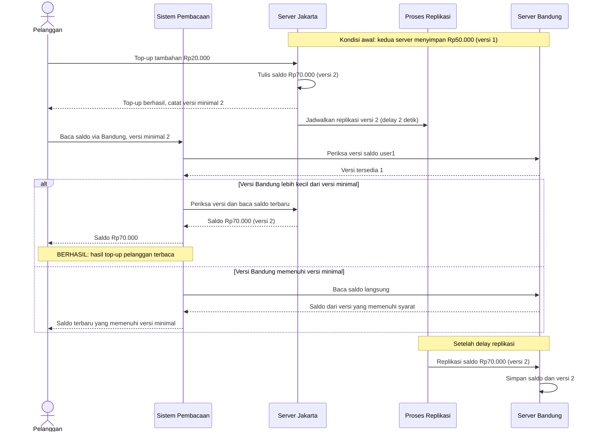
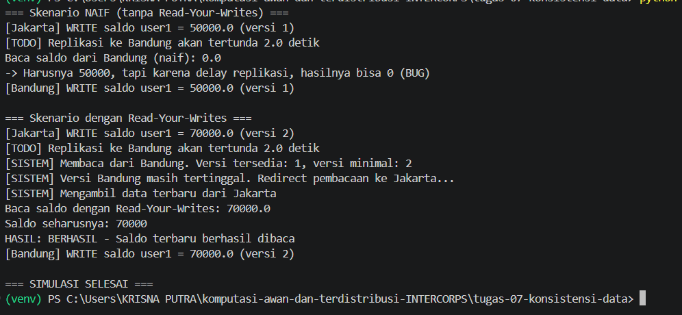

# Tugas 7 (Pekan 7) — Konsistensi Data

**Materi terkait:** Data-Centric Consistency (Sequential, Eventual), Client-Centric Consistency.

## Studi Kasus

Data saldo *e-wallet* pelanggan FoodGo berbeda antara server wilayah **Jakarta** dan **Bandung** karena replikasi antar server berjalan lambat. Contoh kasus nyata: pelanggan top-up saldo lewat server Jakarta, lalu dalam hitungan detik memesan makanan lewat aplikasi yang tersambung ke server Bandung — saldo belum ter-update, transaksi ditolak padahal saldo sebenarnya cukup.

## 1. Analisis Sequential vs Eventual + Usulan Solusi
Analisis Model Konsistensi
Pada kasus e-wallet FoodGo, terdapat dua server (Jakarta dan Bandung) yang saling mereplikasi data saldo. Ketika pelanggan melakukan top-up di server Jakarta, data saldo belum tentu langsung tersedia di server Bandung karena adanya delay replikasi. Akibatnya, pelanggan yang segera melakukan pemesanan melalui server Bandung dapat mengalami penolakan transaksi meskipun saldo sebenarnya sudah mencukupi.

Dalam konteks ini, Eventual Consistency tidak cukup. Eventual Consistency memang memungkinkan sistem berjalan lebih cepat karena replikasi dilakukan secara asinkron, namun inkonsistensi sementara yang terjadi sangat berisiko pada data yang menyangkut uang. Berbeda dengan data non-kritis seperti jumlah like di media sosial, kesalahan pada saldo e-wallet dapat menurunkan kepercayaan pengguna dan berdampak langsung pada pengalaman serta reputasi layanan.
Sequential Consistency dapat menjamin bahwa semua replika melihat urutan operasi yang sama. Namun pendekatan ini terlalu ketat dan mahal karena setiap operasi tulis harus menunggu sinkronisasi ke seluruh replika sebelum dianggap selesai. Hal ini dapat meningkatkan latency secara signifikan, terutama pada sistem yang tersebar secara geografis.

Solusi yang lebih tepat adalah menerapkan Client-Centric Consistency, khususnya model Read-Your-Writes. Dengan mekanisme ini, pelanggan yang baru saja melakukan top-up di server Jakarta akan selalu melihat saldo terbarunya sendiri pada operasi baca berikutnya, meskipun proses replikasi ke server Bandung belum selesai. Pendekatan ini memberikan jaminan yang cukup kuat bagi pengguna tanpa harus memaksa seluruh sistem menjadi Sequential Consistency.
## Tugas Kelompok

## 2. Usulan Solusi: Client-Centric Consistency (Read-Your-Writes)

Solusi yang dipilih adalah **Read-Your-Writes (RYW)**, dengan jaminan Client-Centric Consistency. Mekanisme ini memastikan bahwa setelah pelanggan melakukan penulisan yang berhasil, pembacaan berikutnya oleh pelanggan yang sama tidak kembali ke versi sebelum penulisan tersebut.
Dalam simulasi, setiap pembaruan saldo diberi nomor versi. Aplikasi atau sesi pelanggan mengingat **versi minimal** dari top-up terakhir. Saat hendak membaca saldo di Bandung, sistem membandingkan versi data di Bandung dengan versi minimal tersebut:

1. Jika versi Bandung **lebih besar atau sama dengan** versi minimal, saldo dibaca langsung dari Bandung.
2. Jika versi Bandung **lebih kecil**, sistem tidak menggunakan data lamanya dan mengalihkan pembacaan ke Jakarta, yaitu replika yang telah menerima top-up.
3. Setelah replikasi selesai, Bandung dapat kembali melayani pembacaan langsung karena versinya sudah memenuhi syarat.

## 3. Sequence Diagram

### 3.1 Tanpa Read-Your-Writes (Bug)



**Titik kegagalan:** Bandung melayani pembacaan sebelum memperoleh hasil top-up di Jakarta. Pembaruan pada akhirnya sampai ke Bandung, tetapi pelanggan sudah lebih dahulu menerima saldo lama.

### 3.2 Dengan Read-Your-Writes (Bug Teratasi)



**Titik perbaikan:** Pemeriksaan versi mencegah Bandung mengembalikan data versi 1 kepada pelanggan yang baru saja menulis versi 2. Pembacaan dialihkan ke Jakarta sampai Bandung memiliki data yang cukup baru. Pada kode simulasi, pengalihan ini dilakukan oleh fungsi `baca_saldo_read_your_writes()`.


## Bagian 2: Simulasi Replikasi Data dan Implementasi Read-Your-Writes

### 2.1 Tujuan Simulasi

Simulasi dilakukan untuk membuktikan permasalahan konsistensi data yang terjadi akibat keterlambatan replikasi antara server Jakarta dan Bandung pada sistem e-wallet FoodGo.

Pengujian ini memiliki dua tujuan utama, yaitu:

1. Menunjukkan kondisi inconsistent read ketika server Bandung masih menyimpan saldo lama meskipun server Jakarta sudah menerima pembaruan saldo.
2. Mengimplementasikan mekanisme Read-Your-Writes menggunakan version counter agar pelanggan dapat membaca saldo terbaru tanpa harus menunggu proses replikasi selesai.

Simulasi dibuat menggunakan Python dengan dua replika yang direpresentasikan sebagai objek server Jakarta dan Bandung. Proses replikasi dilakukan secara asinkron menggunakan `threading.Timer` dengan waktu keterlambatan sebesar 2 detik.

### 2.2 Implementasi Simulasi

Implementasi dilakukan melalui file `src/replica_simulation.py` dengan melengkapi tiga bagian TODO yang tersedia pada skeleton program.

**1. Implementasi Delay Replikasi (TODO 1)**

Pada fungsi `top_up()`, setiap transaksi top-up akan memperbarui saldo pada server Jakarta terlebih dahulu. Setelah itu, proses replikasi menuju server Bandung dijadwalkan menggunakan `threading.Timer`.

```python
timer = threading.Timer(
    REPLICATION_DELAY,
    self.bandung.write,
    args=(user_id, saldo_baru, version)
)
timer.start()
```

Variabel `REPLICATION_DELAY` ditetapkan sebesar 2 detik. Dengan demikian, pembaruan saldo di Jakarta tidak langsung tersedia di Bandung.

Mekanisme tersebut digunakan untuk mensimulasikan kondisi ketika pelanggan melakukan top-up melalui Jakarta, kemudian membaca saldo melalui Bandung sebelum proses replikasi selesai.

**2. Implementasi Read-Your-Writes (TODO 2)**

Pada fungsi `baca_saldo_read_your_writes()`, sistem membandingkan versi data yang tersedia pada replika tujuan dengan versi minimal yang dibutuhkan pelanggan.

Jika versi data sudah memenuhi versi minimal, pembacaan dilakukan langsung dari replika tersebut. Namun, apabila versi data masih tertinggal, sistem mengalihkan pembacaan ke server Jakarta yang memiliki data lebih baru.

```python
versi_sekarang = replica.get_version(user_id)

if versi_sekarang >= versi_minimal:
    return replica.read(user_id)

versi_jakarta = self.jakarta.get_version(user_id)

if versi_jakarta >= versi_minimal:
    return self.jakarta.read(user_id)
```

Mekanisme ini memastikan bahwa pelanggan tidak membaca versi data yang lebih lama daripada hasil top-up terakhirnya sendiri.

Pada implementasi yang dibuat, jika Jakarta juga belum memiliki versi minimal, program melakukan polling hingga versi tersebut tersedia.

**3. Pengujian Read-Your-Writes (TODO 3)**

Pengujian dilakukan dengan memanggil fungsi `baca_saldo_read_your_writes()` setelah pelanggan melakukan top-up tambahan sebesar Rp20.000.

```python
saldo = system.baca_saldo_read_your_writes(
    user_id,
    "Bandung",
    versi_terakhir
)
```

Sistem terlebih dahulu memeriksa versi data Bandung. Jika belum sesuai, pembacaan dialihkan ke Jakarta untuk mendapatkan saldo terbaru.

### 2.3 Hasil Pengujian

**A. Skenario Tanpa Read-Your-Writes**

Pada pengujian pertama, pelanggan melakukan top-up sebesar Rp50.000 melalui server Jakarta.

Server Jakarta berhasil memperbarui saldo menjadi Rp50.000 dengan versi 1. Namun, karena proses replikasi menuju Bandung mengalami keterlambatan selama 2 detik, Bandung masih menyimpan saldo lama sebesar Rp0.

Ketika pembacaan dilakukan setelah 0,5 detik, hasil yang diperoleh adalah:

```text
=== Skenario NAIF (tanpa Read-Your-Writes) ===
[Jakarta] WRITE saldo user1 = 50000.0 (versi 1)
[TODO] Replikasi ke Bandung akan tertunda 2.0 detik
Baca saldo dari Bandung (naif): 0.0
-> Harusnya 50000, tapi karena delay replikasi, hasilnya bisa 0 (BUG)
[Bandung] WRITE saldo user1 = 50000.0 (versi 1)
```

Hasil tersebut menunjukkan adanya inconsistent read karena server Bandung mengembalikan saldo Rp0, sedangkan saldo yang sudah tersimpan di Jakarta adalah Rp50.000.

**B. Skenario dengan Read-Your-Writes**

Pada pengujian kedua, pelanggan melakukan top-up tambahan sebesar Rp20.000 sehingga saldo di Jakarta menjadi Rp70.000 dengan versi 2.

Ketika pelanggan membaca saldo melalui Bandung, sistem mendeteksi bahwa Bandung masih menyimpan data versi 1, sedangkan versi minimal yang dibutuhkan adalah versi 2.

Oleh karena itu, sistem mengalihkan pembacaan ke Jakarta.

```text
=== Skenario dengan Read-Your-Writes ===
[Jakarta] WRITE saldo user1 = 70000.0 (versi 2)
[TODO] Replikasi ke Bandung akan tertunda 2.0 detik
[SISTEM] Membaca dari Bandung. Versi tersedia: 1, versi minimal: 2
[SISTEM] Versi Bandung masih tertinggal. Redirect pembacaan ke Jakarta...
[SISTEM] Mengambil data terbaru dari Jakarta
Baca saldo dengan Read-Your-Writes: 70000.0
Saldo seharusnya: 70000
HASIL: BERHASIL - Saldo terbaru berhasil dibaca
[Bandung] WRITE saldo user1 = 70000.0 (versi 2)
```

Hasil pengujian menunjukkan bahwa saldo Rp70.000 berhasil dibaca meskipun proses replikasi menuju Bandung belum selesai.

### 2.4 Perbandingan Hasil Simulasi

| Parameter | Tanpa Read-Your-Writes | Dengan Read-Your-Writes |
|---|---|---|
| Saldo Jakarta | Rp50.000 | Rp70.000 |
| Versi Jakarta | 1 | 2 |
| Versi Bandung saat pembacaan | 0 | 1 |
| Delay replikasi | 2 detik | 2 detik |
| Saldo yang dibaca | Rp0 | Rp70.000 |
| Mekanisme pembacaan | Langsung dari Bandung | Pemeriksaan versi dan redirect ke Jakarta |
| Hasil | Inconsistent Read | Berhasil |

Berdasarkan tabel tersebut, perbedaan utama kedua skenario terletak pada mekanisme pembacaan data.

Pada skenario pertama, sistem langsung membaca data yang tersedia di Bandung tanpa memeriksa apakah data tersebut merupakan hasil pembaruan terbaru.

Sementara itu, pada skenario kedua, sistem menggunakan version counter untuk menentukan apakah replika sudah memiliki data yang dibutuhkan pelanggan.

### 2.5 Bukti Hasil Simulasi

Berikut merupakan hasil eksekusi program yang memperlihatkan kedua skenario pengujian.



### 2.6 Evaluasi dan Kesimpulan Simulasi

Berdasarkan implementasi dan hasil pengujian, mekanisme Read-Your-Writes berhasil mengatasi masalah inconsistent read pada skenario yang disimulasikan.

Tanpa Read-Your-Writes, Bandung mengembalikan saldo Rp0 meskipun Jakarta telah menyimpan saldo Rp50.000. Setelah Read-Your-Writes diterapkan, sistem berhasil membaca saldo terbaru Rp70.000 melalui Jakarta karena versi Bandung masih tertinggal.

Hal tersebut menunjukkan bahwa permasalahan konsistensi pembacaan tidak selalu harus diselesaikan dengan mempercepat replikasi atau menunggu seluruh server tersinkronisasi. Pemeriksaan versi data dan pemilihan replika yang sesuai dapat memastikan pelanggan melihat hasil penulisannya sendiri.

Meskipun demikian, simulasi ini masih terbatas pada satu pelanggan dan dua replika dalam satu proses Python. Mekanisme yang dibuat juga belum menangani kegagalan server, pembacaan dengan timeout, maupun transaksi pembayaran secara bersamaan.

Dengan demikian, Read-Your-Writes dapat menjadi solusi yang relevan untuk meningkatkan konsistensi pembacaan saldo pelanggan pada FoodGo. Namun, pada implementasi e-wallet nyata, mekanisme tersebut tetap perlu dilengkapi dengan pengendalian konkurensi dan transaksi atomik untuk menjaga keamanan saldo.

### Bagian 1 — Analisis (wajib)

1. Tentukan: apakah kasus ini **membutuhkan Sequential Consistency** (semua replika melihat urutan operasi yang sama) atau **cukup Eventual Consistency** (replika akan konsisten "pada akhirnya", boleh sementara berbeda)? Berikan argumen berbasis dampak bisnis (mis. kasus saldo *e-wallet* jauh lebih sensitif dibanding kasus "jumlah like" di media sosial).
2. Jika kalian menyimpulkan Eventual Consistency saja **tidak cukup** untuk skenario ini, usulkan pendekatan **Client-Centric Consistency** yang relevan (mis. *Read-Your-Writes*: pelanggan yang baru top-up harus selalu melihat saldo terbarunya sendiri, walau replika lain belum sinkron).
3. Gambarkan **diagram alir urutan (sequence diagram)** yang menunjukkan operasi read/write antara pelanggan, server Jakarta, server Bandung, dan proses replikasi — untuk skenario **tanpa** jaminan konsistensi (bug terjadi) DAN skenario **dengan** solusi yang kalian usulkan (bug teratasi). Pakai Mermaid (`sequenceDiagram`) di `README.md` — lihat contoh cara pakai di Tugas 2.

### Bagian 2 — Simulasi (opsional, nilai tambah)

Skeleton `src/replica_simulation.py` mensimulasikan dua replika (Jakarta & Bandung) dengan delay replikasi buatan. Lengkapi TODO untuk:
1. Menunjukkan kondisi **inconsistent read** (replika Bandung masih menunjukkan saldo lama walau Jakarta sudah update).
2. Mengimplementasikan mekanisme **Read-Your-Writes** sederhana (mis. dengan version/timestamp per client) yang memperbaiki masalah tersebut.

```bash
python3 src/replica_simulation.py
```


## Struktur Submission

```
tugas-07-konsistensi-data/
├── README.md      # Analisis konsistensi + sequence diagram Mermaid
├── JURNAL.md
├── src/            # (opsional) simulasi replikasi
└── bukti/          # (jika mengerjakan simulasi) output program
```

## Rubrik Penilaian (Tugas 7)

| Komponen | Bobot | Kriteria |
|---|---|---|
| Ketepatan pemilihan model konsistensi | 30% | Argumen berbasis dampak bisnis nyata, bukan hafalan definisi |
| Kualitas sequence diagram | 30% | Menunjukkan jelas titik kegagalan & titik perbaikan |
| Usulan solusi client-centric | 25% | Solusi konkret dan dapat diimplementasikan (bukan wacana abstrak) |
| Proses & kontribusi kelompok | 15% | `JURNAL.md`, commit history (+ bonus jika simulasi dikerjakan) |

## Batasan Penggunaan AI (Level 2)

Kebijakan **Level 2 (AI Assisted Idea Generation & Structuring)** berlaku — lihat [`../RUBRIK-UMUM.md`](../RUBRIK-UMUM.md). Boleh bertanya konsep umum consistency model ke AI untuk brainstorming; **tidak boleh** meminta AI menuliskan analisis akhir/sequence diagram atau isi `# TODO` di `src/replica_simulation.py` yang tinggal ditempel. Catat pemakaian AI di "Log Penggunaan AI" pada `JURNAL.md`.

- Sebagai bukti pemahaman konsep (bukan hafalan jawaban skenario FoodGo saja), `README.md` wajib menyertakan **satu skenario tambahan** yang kalian buat sendiri (mis. kasus lain di aplikasi ojek online) dan menentukan model konsistensi yang tepat untuk skenario tambahan tersebut.
